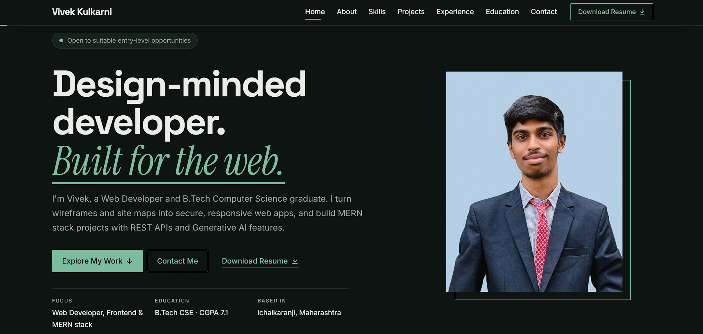

# Vivek Kulkarni — Personal Portfolio

A responsive, lightweight personal portfolio website built with vanilla HTML5, CSS3, and JavaScript to showcase full-stack web development projects, technical skills, and resume details.

[![Live Demo]]
(https://your-live-portfolio-url.com)

---

## Preview



## Features

- **Responsive Layout:** Adapts cleanly across mobile, tablet, and desktop viewports.
- **Interactive UI:** Smooth navigation, dynamic UI interactions, and clean animations powered by vanilla JavaScript.
- **Project Showcase:** Dedicated cards highlighting live web applications with visual previews and links.
- **Direct Resume Access:** Built-in access to view or download the latest PDF resume (`Vivek_Kulkarni_Resume.pdf`).
- **Fast & Lightweight:** Zero heavy build steps—optimized static assets under 550 KB total for near-instant page loads.

## Featured Projects

| Project | Description | Tech Stack | Links |

| **Estato** | Real estate property listing platform featuring dynamic property search filters and responsive layouts. | HTML5, CSS3, Bootstrap, JavaScript, jQuery | [Live Demo](https://your-estato-link.netlify.app) · [Code](https://github.com/your-username/estato) |
| **GameZone** | Interactive browser gaming hub featuring classic arcade and puzzle games including Snake, 2048, Minesweeper, and Flappy Bird. | HTML5, CSS3, Bootstrap 5, JavaScript, jQuery | [Live Demo](https://your-gamezone-link.netlify.app) · [Code](https://github.com/your-username/gamezone) |

## Project Structure

```text
Vivek-Kulkarni-Portfolio/
├── index.html
├── README.md
└── assets/
    ├── css/
    │   └── style.css
    ├── js/
    │   └── script.js
    ├── documents/
    │   └── Vivek_Kulkarni_Resume.pdf
    └── images/
        ├── profile-img.jpg
        ├── estato-prj.jpg
        └── game-zone-prj.jpg